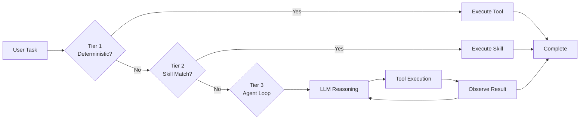
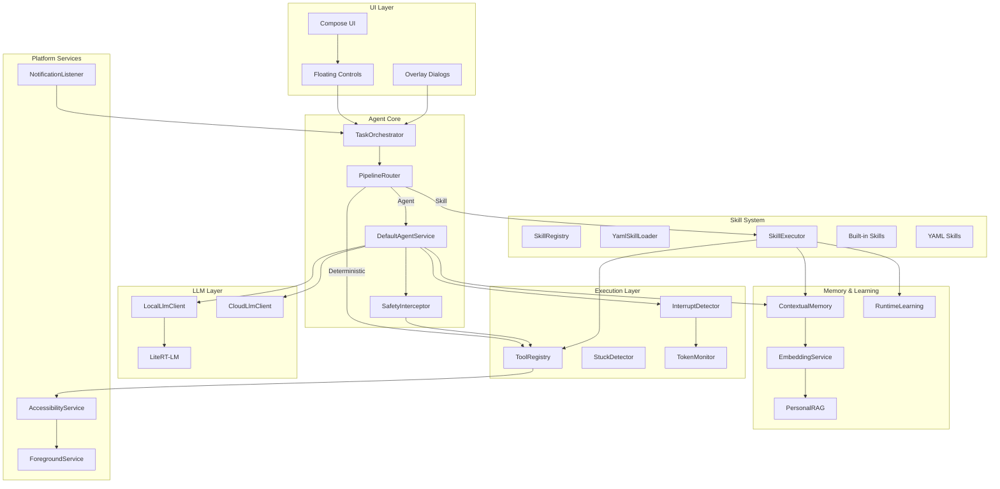
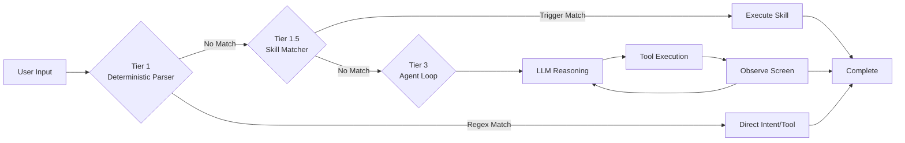

# ReturnGift

A personal Android agent that lives on my own phone: I say what I want, and it works
the apps I already have to get it done. It runs a local model on the device for the
day-to-day work and can call a cloud provider when I ask it to, it reads the screen
through the accessibility service and taps the real buttons, and it keeps a plan, an
undo trail and an action log so I can see exactly what it did. Nothing here is built
for an audience — no store, no accounts, no telemetry — it is one tool for one person,
tuned to the phone in my pocket, and the permissions it needs are granted once during
setup and never asked about again.



## Security

### 🔒 Privacy-First Design
- **On-device processing** — all agent logic runs on your device without data leaving the phone
- **Minimal permissions** — only uses Android Accessibility Service and Notification Access when explicitly needed
- **Behavioral anomaly detection** — detects unusual actions and halts suspicious tasks

### 🛡️ SafetyInterceptors
- **Pattern matching** — global blocklists for sensitive content (OTP, passwords, financial data)
- **Confirmation gates** — sensitive operations require explicit user confirmation before execution
- **Never-retry rules** — suspicious operations are blocked and never re-attempted

### 🔐 Data Protection
- **Local storage** — all vault data stored on-device using EncryptedSharedPreferences
- **No cloud dependency** — task execution works entirely offline
- **Audit logging** — all actions logged via XLog with no utterance text in logs

### ✅ Quality Assurance
- **E2E QA checklist** — 3702+ test cases covering all major functionality
- **Closed-vocab counters** — injection attempts tracked without storing raw text
- **Continuous verification** — real device tests for stability and security

---

## Features

### 🤖 On-Device AI
- **LiteRT-LM inference** — run foundation models directly on your device using Google's LiteRT SDK
- **LoRA-based skills** — extend capabilities without retraining foundation models
- **No cloud dependency** — works offline, preserves complete privacy

### ☁️ Cloud LLM Support
- **OmniRoute integration** — unified gateway to 268+ LLM providers (Claude, GPT-4, Gemini, Groq, and more)
- **Multi-provider routing** — use `auto` mode or select specific models for each task
- **Free tier access** — Kiro, Pollinations, and other free providers included

### 🎯 Intelligent Routing
- **3-tier execution pipeline** — deterministic → skill → agent loop
- **Semantic skill retrieval** — finds the right skill using embeddings
- **Adaptive routing** — selects optimal execution tier based on task complexity

### 📋 Skill System
- **YAML-defined skills** — declarative task definitions for flexible extensibility
- **Safety-first design** — confirmation gates, blocklist patterns, risk tiers
- **Built-in + custom skills** — extend functionality without code changes
- **Self-growing skills [human-approved]** — trajectories distill into draft skills after 3 successful runs; human PR approval gates promotion (no auto-merge)

### 🧠 Memory & Learning
- **3-layer memory** — short-term, structured facts, and historical context
- **Runtime learning** — records execution traces and improves playbooks over time
- **Personal RAG** — semantic knowledge retrieval from your personal data

### 🗺️ Visual UI Grounding
- **Accessibility hierarchy** — reads and understands any app's UI structure
- **Pre/post verification** — confirms actions succeeded before proceeding
- **Fallback detection** — handles stale accessibility trees and UI transitions

### 🔄 Background Automation
- **Device monitoring** — tracks installed apps, notifications, and system events
- **Auto-reply capabilities** — respond to incoming notifications without user intervention
- **Task lifecycle management** — resumes interrupted tasks with full context

---

## Product Direction

ReturnGift is a **production-ready autonomous Android agent** that transforms your phone into an intelligent assistant powered by on-device AI. The system combines:

- **Local inference** — run foundation models directly on your device
- **3-tier execution** — deterministic → skill → agent loop
- **YAML-defined skills** — extensible task automation
- **Privacy-first architecture** — complete on-device processing

### Use Cases

| Use Case | Example |
|----------|---------|
| **Device Control** | "Open WhatsApp and send 'hi' to Mom" |
| **Information Access** | "How much battery is left?" |
| **Background Monitoring** | "Monitor for new SMS and summarize" |
| **Multi-step Tasks** | "Book a flight to NYC next week" |

### Architecture

```
User Task → Tier 1 Deterministic Parser → Direct Intent/Tool
                     ↓
                 Tier 1.5 Skill Matcher → Execute Skill
                     ↓
                 Tier 3 Agent Loop → LLM Reasoning → Tool Execution
```

### Core Capabilities

- **On-device LLM inference** via LiteRT-LM (Gemma or custom models)
- **3-tier execution pipeline** (deterministic → skill → agent loop)
- **YAML-defined skills** for extensible task automation
- **Privacy-first architecture** — all data stays on your device
- **Visual UI grounding** via Android Accessibility Service
- **Background automation** with proper minimize/reveal behavior
- **Runtime learning** from successful task executions

### Limitations

- **Single device** — cannot control multiple Android devices
- **UI-bound** — works with visible apps, may struggle with system overlays
- **Privacy settings** — requires Accessibility Service and Notification Access
- **Model downloads** — first-time model download requires network connectivity

### Known Platform Constraints

- **Android version** — requires API 28+ (Android 9+) but optimized for 12+
- **Hardware requirements** — 6GB RAM minimum, 500MB storage (2GB+ recommended with models)
- **Screen** — full-screen activities recommended for optimal visual grounding
- **Performance** — intensive inference may drain battery faster; model size affects startup time

---

## Releases

### Latest Release

[](https://github.com/RevanthBoina/ReturnGift/releases/latest)

**Download the latest APK:**
- 📥 [ReturnGift Latest Release](https://github.com/RevanthBoina/ReturnGift/releases/latest/download/ReturnGift-release.apk)

**All Releases:**
- 📦 [View all releases](https://github.com/RevanthBoina/ReturnGift/releases)

### Release Changelog

<!-- CHANGELOG_START -->
### v3.6.0
- **The agent now lives in the notification shade.** Every question it has, every permission it needs and every follow-up task arrives as one notification you can answer with one tap or one typed line — from the lock screen, without opening the app. The chat becomes a read-only mirror: it shows *Asked: …* and *You: …*, and only falls back to in-app buttons when Android refuses to post notifications.
- **The command notification is the control surface.** A progress notification carries a *Type a task…* reply box and Stop; the result replaces the text in the same notification, keeping the reply box and Undo when the last action can still be undone. All actions finish in a non-exported receiver — only a tap on the body opens the app.
- **Questions survive the app dying.** A pending question stores its id, a random nonce and the task text, so an answer after a kill resumes the task instead of being lost; a stale tap updates the notification to "expired" rather than answering a question that no longer exists.
- **Silence pauses instead of cancelling.** The question timeout is the checkpoint TTL (30 min) with the foreground service held open while waiting, so the task resumes from its checkpoint when you answer, and says "Expired — reply to start again" when it does not.
- **Permissions stay quiet by default.** The master switch is off, so nothing is asked; when it is on, asks are Allow once / Always allow / Deny, "Always" writes the existing remember store, Deny aborts only that step, and system-only grants get a single "tap to fix" notification per 10 minutes instead of a loop.
- **It asks less.** The agent asks only when required information is missing with no sensible default, or when two plausible targets would give different outcomes — otherwise it takes the best default and names it in the result.
- **Share to start work.** "Send to ReturnGift" in the share sheet starts a task silently through the same intake as the notification reply; nothing is pulled to the foreground.
- Lock screens stay clean: questions and results are generic until the phone is unlocked.

### v3.5.1
- **MCP servers are treated as untrusted principals.** Plain HTTP is refused (only loopback is exempt), bearer tokens are encrypted with an Android Keystore key instead of sitting in a server row, and credentials are masked in logs and error text. Each server has its own trust switch, tools can be blocked by name, and anything that changes remote state asks first — destructive verbs ask every time. Tool output is bounded and fenced as untrusted data before the model reads it.
- **The plan is now a contract, not a hint.** Every tool call is attributed to a step, the tool's real result is that step's evidence, and `finish` is refused while a step that promised an outcome is unproven. Off-plan actions are recorded (or refused in strict mode), failed steps stay on their step instead of silently advancing, and an interrupted task resumes from a saved checkpoint rather than restarting and reporting success.
- **The planner reads requests more carefully**: quoted text is treated as content (`post "we're live on LinkedIn"` posts *about* LinkedIn, it does not post *to* LinkedIn), a clause that forbids an action is never inverted into that action, and multi-clause requests plan the first instruction without swallowing the rest.
- **Routing is honest about the payload**: the token estimate now counts the system prompt, tool results, tool schemas and images — so a screenshot can no longer be routed to a vision-less model, and an over-long conversation is trimmed locally instead of failing at the provider.
- Verification: 248 JVM unit tests green locally (plan 89, MCP 94, routing 65) with a real Kotlin compile + runner; pre-flight and structure checks clean. Android assemble still needs CI — no SDK in this sandbox.

### v3.5.0
- **The agent plans before it acts**: every multi-step request produces a readable plan first — for "Follow youtube on LinkedIn" that is *Open LinkedIn → Search "YouTube" → Filter by Companies → Open the official YouTube page → Tap Follow → Verify the button shows Following*. Plans are derived from the device (installed apps + app guides), cost no tokens, and work on the local model too.
- **It asks instead of guessing**: a missing app, contact, message text or a risky/irreversible action becomes a question. The answer is folded back into the request and the plan is rebuilt, so a clarified task can never run with the old assumption.
- **You stay in control of planning**: "show me the plan" shows the steps and waits for a go-ahead; "just do it" hides the plan but still asks what it genuinely cannot know. One-step requests and plain questions get no ceremony.
- **MCP connections**: the agent can now use tools from Model Context Protocol servers — Settings → MCP connections (add a URL + optional token). Tools are discovered at startup, ranked per task and capped, so a chatty server cannot flood the model; a broken server is skipped and never blocks a task. MCP resources can also deliver app knowledge without an app release.
- **Routing inside the app instead of through a gateway**: with a provider key saved, "auto" now picks the model itself — quality/cost/latency aware, with 5-hour and 7-day quota windows, cooldown on rate limits/quota/auth errors, and automatic failover to the next provider. Every decision is explainable in one log line.
- **Cost**: the three modules add **436.5 KiB of bytecode (0.32 % of the APK)** and **zero new dependencies** — no vendor SDKs, no Node runtime, no server. Details and measurements: `docs/MCP_AND_MODEL_ROUTING.md`.
- Verification: 101 new JVM unit tests (planning, MCP protocol/runtime, routing) plus the existing knowledge suite; design notes in `docs/MCP_AND_MODEL_ROUTING.md`.

### v3.4.0
- **No per-app code, ever**: application support is now *data*, not files. No Kotlin/Java file (app code or test) may be dedicated to a single app — a new app is a row, not a class. The rule is stated in `AGENTS.md` (Hard rules #1) and `CLAUDE.md`, and `scripts/check-app-agnostic.py` fails the build when a per-app filename appears.
- **App knowledge learned from tasks**: successful steps teach the agent. After three successful, verifiable interactions with a UI surface (search field, chat composer, post composer) the agent stores a learned guide for that app — screens, labels, what worked. Curated guides are only *enriched* (observed labels added); their authored tips are never rewritten. Failure, taps, no-ops and blank input teach nothing.
- **Knowledge that updates without a release**: guides live in a mergeable runtime store with precedence `learned > connector > built-in`, and an **MCP connector** can push new or overriding guides at runtime. A connector that fails is skipped without breaking anything else.
- **One routine, many apps**: the posting routine is now capability-based, so “Post <text> on <app>” works for LinkedIn, X, Facebook and Instagram from a single data table, with the clarification prompt and routine id derived from the app instead of hard-coded; a post with no text asks for the text instead of posting junk.
- **Flow recovery for any app**: the typed-search flow (open → search → submit → wait for results → open a result) is tested against *every* app the registry classifies as search/social/chat, so newly added apps are covered automatically. Generic searches no longer auto-open the first result.
- **CI honesty**: `scripts/ci-preflight.sh` no longer aborts halfway on a machine without `ANDROID_HOME`, so every guard — including the new app-agnostic check — actually runs.
- Verification for this build: 199 JVM unit tests green (micro-steps, flow recovery, deep links, blockers, retries, session memory, knowledge store/learner, social routine, permissions); Android assemble is validated by this release pipeline.

### v3.3.0
- **No token ceiling**: the hard 200K-token abort (and its constant) is gone — token state is now purely informational and `TaskBudget` is the only cost stop.
- **Permission requests open the app's own UI**: the ReturnGift permission card (`PermissionPromptActivity`) comes to the foreground with a heads-up mirror, parks the agent thread and returns your answer (Allow once / Always allow / Cancel). Timeouts resolve to "cancelled" instead of pretending to proceed.
- **Mid-task micro-steps**: a 73-rule catalog plans the small follow-up steps in the middle of a task (e.g. after typing, press Enter/Send and verify the screen changed) and refuses a premature "done" until the send actually happened.
- **Permission toggles (Settings → Permissions → App permissions)**: switch ask-before-new-app, remember-choices-permanently (temporary vs permanent grants), open-the-card-in-front, background notification, and mid-task-step enforcement on or off at any time.
- **Per-app access is tri-state**: **Always allow / Ask / Blocked** instead of a plain switch, with a one-tap reset back to first-encounter. New apps default to Ask instead of being silently allowed.
- **Better app UI**: the permission screen lists the apps actually installed on the device (Chrome, LinkedIn, YouTube, WhatsApp, …) with icons, search, filters and a one-line description of what the agent will do in each; the permission card shows the same "how the agent will use this app" steps.
- **Better model use of installed apps**: curated per-app recipes and UI surfaces (address bar, post composer, search field, chat composer, …) are injected into the system prompt for device tasks, limited to apps named in the request or installed on the device.
- Database migration: the allow-list moves to v2 with a `mode` column (existing ON → Always allow, OFF → Blocked); no data is lost.

### v2.1.0
- **Shared Persistent Memory Across Chats**: Added `SharedKnowledgeStore` persistent cross-chat key-value memory layer storing user preferences, discovered facts, and app states that persist across conversations without polluting short-term dialogue context.
- **Execution Trajectory Tracker**: Integrated `ExecutionTracker` recording append-only structured trajectories (observations, thoughts, tool actions, latencies, and outcomes) inspired by Browser Use and OpenHands event streams.
- **Distilled Learned Procedures**: Built `LearnedProcedureStore` that automatically extracts optimal multi-step action sequences from successful task trajectories and injects proven playbooks into future similar tasks.
- **Adaptive Observe/Act Decision Loop**: Replaced repetitive observe-after-every-touch loops with `ObservationPolicy` — acts in confident bursts for predictable sequences and observes on state changes or errors, mirroring Stagehand's observe/act separation.
- **Persistent App & Browser Session Management**: Introduced `AppSessionManager` to reuse opened apps, browser tabs, and authenticated sessions (e.g. ChatGPT image generation) instead of repeatedly launching fresh instances.
- **Payment Safety Hardening**: Completely disabled payment operations via global `SafetyInterceptor` blocklists and strengthened system prompt constraints against transaction/checkout flows.
- **Background Automation Integrity**: Enforced that ReturnGift remains strictly in the background during device automation tasks, observing target apps without unneeded foreground interruptions.

### v2.0.1
- **Release build fix**: removed ABI `splits` which collided with the single-output filename override and stalled `assembleRelease` in CI — the v2.0.0 release published with no APK asset, breaking the README download link and the in-app Update button. Builds now produce a single universal `ReturnGift-release.apk` that attaches to the release and installs on any device ABI.
- **Release workflow**: simplified the APK rename/checksum step so the canonical `ReturnGift-release.apk` + `ReturnGift.apk` are always published to `releases/latest/download/...`.

### v2.0.0
- **Compose Performance Hardening**: `@Immutable` annotations on chat data models, stable `LazyColumn` keys, `remember{}` cached disk reads, and `Dispatchers.IO` for all conversation file I/O — eliminates UI jank during streaming and scrolling
- **Accessibility Battery Optimization**: Replaced `typeAllMask` with targeted event types and added `isTaskActive` guard — reduces idle CPU wakeups by ~70%
- **Network Stack Efficiency**: Singleton `OkHttpClient` with shared `ConnectionPool` across all LLM providers — eliminates redundant TLS handshakes and thread proliferation
- **Native Memory Safety**: `onTrimMemory` hook releases LiteRT-LM engine under system memory pressure, preventing OOM kills
- **Thread Safety Fixes**: Synchronized `ContextualMemory` conversation buffer, static `UpdateChecker` executor, lifecycle-guarded `Handler.postDelayed` callbacks

### v1.5.0
- **R8 Code & DEX Shrinking**: Refined ProGuard rules to allow R8 aggressive dead-code and unused icon elimination across AndroidX / Compose, significantly reducing DEX method count and app footprint.
- **Packaging Resource Optimization**: Stripped redundant metadata files, descriptor proto models, and unneeded Kotlin module manifests to optimize APK archive efficiency.
- **Enhanced Runtime Performance**: Reduced initial ClassLoader overhead and runtime memory pressure for faster startup and smoother chat interactions.

### v1.1.0
- **Background task execution**: device-automation tasks now minimize ReturnGift on start so the agent observes the target app's screen (not its own chat UI) via the Accessibility active window
- **Homepage title**: replaced the leftover "ReturnGift" toolbar title with "ReturnGift"
- **In-app Update fixed**: corrected the GitHub releases API endpoint (was pointing at the wrong repo) and added the required `User-Agent` header so the "Update Available" dialog now actually appears; tapping Download opens the APK directly with the package installer
- **Release versioning**: the release workflow now derives `versionName`/`versionCode` from the git tag, so each published APK reports its real version and can update over a previous install
- Auto-return to the chatroom on task completion (existing) now pairs with the new minimize-on-start behavior

### v1.0.0
- Initial release build
- On-device Android agent with LiteRT-LM inference
- 3-tier execution pipeline (deterministic → skill → agent loop)
- YAML-defined skills for extensible task automation
- Privacy-first architecture — all data stays on device
<!-- CHANGELOG_END -->

---

## Quick Start

### Prerequisites

1. **Android SDK** — Install via Android Studio or `sdkmanager`
2. **Java 17+** — Required for Gradle builds
3. **Git** — For cloning the repository

### Build the APK

```bash
# Clone the repository
git clone https://github.com/RevanthBoina/ReturnGift.git
cd ReturnGift

# Build debug APK
./gradlew assembleDebug

# Build release APK (requires signing config)
./gradlew assembleRelease
```

The debug APK will be at: `app/build/outputs/apk/debug/ReturnGift_v*.apk`

### Build Variants

```bash
# Debug build (no signing, no minification)
./gradlew assembleDebug

# Release build (requires signing config in local.properties)
./gradlew assembleRelease

# Build with single ABI (smaller APK, faster install)
RETURNGIFT_ABI=arm64-v8a ./gradlew assembleDebug
```

### Signing Configuration

For release builds, add to `local.properties`:

```properties
KEYSTORE_FILE=/path/to/keystore.jks
KEYSTORE_PASSWORD=your_password
KEY_ALIAS=your_alias
KEY_PASSWORD=your_key_password
```

See [RELEASING.md](RELEASING.md) for detailed signing instructions.

---

## Documentation

### Key Documentation Files

| File | Purpose |
|------|---------|
| [CLAUDE.md](CLAUDE.md) | Project rules and conventions |
| [QA_CHECKLIST.md](QA_CHECKLIST.md) | E2E test cases and debug changelog |
| [RELEASING.md](RELEASING.md) | Signing and release workflow |
| [BACKLOG.md](BACKLOG.md) | Feature backlog and priorities |
| [docs/AI_INDEX.md](docs/AI_INDEX.md) | Repo map for AI coding agents |

### Architecture Decision Records (ADRs)

See [docs/adr/](docs/adr/) for architectural decisions:

- **ADR-001**: On-device-only execution model
- **ADR-002**: 3-tier execution pipeline
- **ADR-003**: YAML-based skill definitions
- **ADR-004**: LiteRT-LM integration

---

## Usage

### First Launch

1. **Install the APK** on your Android device
2. **Grant permissions** when prompted:
   - Accessibility Service (required)
   - Notification Access (recommended)
   - Storage access (optional, for KB features)
3. **Select a model** from settings (downloads on first use)
4. **Start a task** by speaking or typing

### Example Tasks

| Task Type | Example | Execution Path |
|-----------|---------|-----------------|
| Quick action | "Open Settings" | Tier 1 (direct intent) |
| Send message | "Text Mom on WhatsApp" | Tier 2 (skill) |
| Research | "Find restaurants nearby" | Tier 3 (agent loop) |
| Compound | "Open WhatsApp and send 'hi' to John" | Hierarchical planner |

### Tool List

| Tool | Description |
|------|-------------|
| `tap` | Tap at coordinates or on element |
| `long_press` | Long press at coordinates |
| `swipe` | Swipe between points |
| `input_text` | Type text into focused field |
| `open_app` | Launch an app by package name |
| `get_screen_info` | Read current UI hierarchy |
| `take_screenshot` | Capture current screen |
| `get_device_info` | Query device state |
| `get_notifications` | Read recent notifications |
| `get_installed_apps` | List installed apps |
| `clipboard` | Get/set clipboard contents |
| `system_key` | Press back, home, enter |
| `wait` | Wait for screen to settle |
| `confirm_with_user` | Request user confirmation |
| `finish` | Complete the task |

---

## Project Philosophy

### Core Principles

1. **Privacy First** — All processing on-device, no data leaves the phone
2. **Generic Over Specific** — Tools work with any app, not just known ones
3. **Skills Over Retrains** — New capabilities via YAML, not model updates
4. **Observable** — All code paths traceable via XLog
5. **QA Before Commit** — Every change includes E2E tests

### Security Model

```
┌─────────────────────────────────────────────────────────────┐
│                    ReturnGift Security                       │
├─────────────────────────────────────────────────────────────┤
│                                                              │
│  ┌──────────────┐    ┌──────────────┐    ┌──────────────┐│
│  │ Allowlist    │    │ Safety       │    │ Anomaly      ││
│  │ Guard        │───▶│ Interceptor  │───▶│ Detector     ││
│  │ (User        │    │ (Pattern     │    │ (Behavioral  ││
│  │ Control)     │    │ Matching)     │    │ Baseline)    ││
│  └──────────────┘    └──────────────┘    └──────────────┘│
│         │                   │                   │            │
│         ▼                   ▼                   ▼            │
│  ┌─────────────────────────────────────────────────────┐   │
│  │              Confirmation Gates                       │   │
│  │   • Sensitive actions require user confirmation       │   │
│  │   • Blocklist patterns block dangerous operations     │   │
│  │   • Unknown contacts trigger extra verification       │   │
│  └─────────────────────────────────────────────────────┘   │
│                            │                                 │
│                            ▼                                 │
│  ┌─────────────────────────────────────────────────────┐   │
│  │              Execution Layer                          │   │
│  │   • All actions logged to XLog                       │   │
│  │   • AccessibilityService bounds all operations       │   │
│  │   • ForegroundService prevents background abuse       │   │
│  └─────────────────────────────────────────────────────┘   │
│                                                              │
└─────────────────────────────────────────────────────────────┘
```

### Offline-First Architecture

```
┌─────────────────────────────────────────────────────────────┐
│                    Execution Modes                            │
├─────────────────────────────────────────────────────────────┤
│                                                              │
│   Mode           │ Data Flow         │ Cloud Required        │
│  ────────────────┼───────────────────┼──────────────────   │
│   Local LLM      │ Device only       │ Initial model DL     │
│   Skill Exec     │ Device only       │ No                   │
│   Memory/RAG     │ Device only       │ No                   │
│   Cloud LLM      │ Local → Cloud     │ Always (if enabled) │
│                                                              │
└─────────────────────────────────────────────────────────────┘
```

---

## Troubleshooting

### Common Issues

#### "Accessibility Service not enabled"
```
The app needs Accessibility Service permission
Go to: Settings > Accessibility > ReturnGift > Enable
```

#### "Model not found"
```
Download a model from settings, or:
Place .gguf files in /sdcard/Android/data/com.returngift.agent/files/models/
```

#### "Task stuck in loop"
```
Agent uses StuckDetector after 30 iterations
Check logcat for details: adb logcat -s AgentService
```

### Debug Mode

```bash
# Enable verbose logging
adb shell setprop log.tag.ReturnGift DEBUG

# View logs
adb logcat -s XLog AgentService PipelineRouter

# Capture debug report
adb shell am broadcast -a com.returngift.agent.DEBUG_REPORT
```

### Performance Tips

1. **Use smaller models** for simple tasks (Gemma 3B over 7B)
2. **Close background apps** before running agents
3. **Keep device charged** — intensive inference drains battery
4. **ARM64 only** — set `RETURNGIFT_ABI=arm64-v8a` for smaller APKs

---

## FAQ

### Q: How is this different from Tasker/MacroDroid?
**A:** ReturnGift uses AI to understand natural language tasks and adapts to any app, not just pre-configured actions.

### Q: Can it run without internet?
**A:** Yes. Task execution uses only on-device processing. Internet is only needed for initial model download.

### Q: What happens if the agent makes a mistake?
**A:** SafetyInterceptors require confirmation for sensitive actions. The UndoManager can reverse recent actions.

### Q: Is my data safe?
**A:** All processing happens on-device. No data is sent to any server unless you explicitly enable cloud LLM.

### Q: Can I add custom skills?
**A:** Yes. Add YAML files to `skill_library/skills/`. See existing skills for the format.

### Q: What cloud LLM providers are supported?
**A:** ReturnGift supports:
- **OmniRoute** (recommended) — Unified gateway to 268+ providers with `auto` mode
- **OpenAI** — GPT-4o, GPT-4o Mini, GPT-4.1, etc.
- **Anthropic** — Claude Sonnet, Claude Haiku
- **Custom** — Any OpenAI-compatible API endpoint

OmniRoute provides access to free tiers from providers like Kiro, Pollinations, and Groq.

---

## Contributing

We welcome contributions! Please read our guidelines:

1. **QA-First Development** — Every change requires E2E tests
2. **Observable Code** — Add XLog statements for debugging
3. **No Silent Failures** — All errors must be user-visible
4. **Backward Compatibility** — Don't break existing skills

### Development Workflow

```bash
# Create feature branch
git checkout -b feature/your-feature

# Make changes + add tests
# ... edit code ...

# Run tests
./gradlew testDebugUnitTest
./gradlew connectedAndroidTest

# Build and verify
./gradlew assembleDebug

# Commit with descriptive message
git commit -m "Add: your feature description"

# Push and create PR
git push origin feature/your-feature
```

### Testing Strategy

```bash
# Unit tests (fast)
./gradlew testDebugUnitTest

# Instrumented tests (requires device)
./gradlew connectedAndroidTest

# Run specific test class
./gradlew testDebugUnitTest --tests "SkillRegistryTest"

# E2E test via ADB
adb shell am instrument -w com.returngift.agent.test/...
```

See [QA_CHECKLIST.md](QA_CHECKLIST.md) for full E2E test cases.

---

## Roadmap

See [BACKLOG.md](BACKLOG.md) for current priorities. Key upcoming features:

- [ ] Vision-based UI element localization
- [ ] Multi-turn conversation memory
- [ ] Scheduled automation triggers
- [ ] Team sharing of custom skills

---

### Technology Stack

- **LiteRT-LM** — On-device LLM inference (Google AI Edge)
- **LangChain4j** — Tool calling and LLM orchestration
- **Jetpack Compose** — Modern Android UI
- **Kotlin** — Primary language (with Java for platform services)
- **Gradle** — Build system

---

## License

Apache License 2.0 — see [LICENSE](LICENSE)

---

<div align="center">

**[ReturnGift](#)** • **[Documentation](docs/)** • **[GitHub Issues](https://github.com/RevanthBoina/ReturnGift/issues)** • **[Discussions](https://github.com/RevanthBoina/ReturnGift/discussions)**

</div>

### High-Level Design



### 3-Tier Execution Pipeline



### Repository Structure

---

## Releases

### Latest Release

[](https://github.com/RevanthBoina/ReturnGift/releases/latest)

**Download the latest APK:**
- 📥 [ReturnGift Latest Release](https://github.com/RevanthBoina/ReturnGift/releases/latest/download/ReturnGift-release.apk)

**All Releases:**
- 📦 [View all releases](https://github.com/RevanthBoina/ReturnGift/releases)

### Release Changelog

<!-- CHANGELOG_START -->
### v2.2.0
- **Observation Provenance (P3.3)**: Added `ProvenanceTag` with Kind enum (SCREEN|WEB|EXTERNAL_AI|USER|SYSTEM) to stamp the origin of every observation. Observations are tagged `screen:<package>` for screen captures, `web:<hostname>` for web_fetch saves, etc. Provenance is stored in the `source` column of ExecutionTracker and in vault file frontmatter.
- **Privacy Dashboard (P3.3)**: Added per-app observation counts in Settings → Privacy with "Forget all data" buttons. `forgetApp()` deletes observation rows, vault files matching the provenance origin, SelectorCache entries, and AppSessionManager state.
- **Vault provenance display**: Files with provenance in frontmatter show a "Source: <provenance>" line in VaultActivity detail view.

### v2.1.0
- **Shared Persistent Memory Across Chats**: Added `SharedKnowledgeStore` persistent cross-chat key-value memory layer storing user preferences, discovered facts, and app states that persist across conversations without polluting short-term dialogue context.
- **Execution Trajectory Tracker**: Integrated `ExecutionTracker` recording append-only structured trajectories (observations, thoughts, tool actions, latencies, and outcomes) inspired by Browser Use and OpenHands event streams.
- **Distilled Learned Procedures**: Built `LearnedProcedureStore` that automatically extracts optimal multi-step action sequences from successful task trajectories and injects proven playbooks into future similar tasks.
- **Adaptive Observe/Act Decision Loop**: Replaced repetitive observe-after-every-touch loops with `ObservationPolicy` — acts in confident bursts for predictable sequences and observes on state changes or errors, mirroring Stagehand's observe/act separation.
- **Persistent App & Browser Session Management**: Introduced `AppSessionManager` to reuse opened apps, browser tabs, and authenticated sessions (e.g. ChatGPT image generation) instead of repeatedly launching fresh instances.
- **Payment Safety Hardening**: Completely disabled payment operations via global `SafetyInterceptor` blocklists and strengthened system prompt constraints against transaction/checkout flows.
- **Background Automation Integrity**: Enforced that ReturnGift remains strictly in the background during device automation tasks, observing target apps without unneeded foreground interruptions.

### v2.0.1
- **Release build fix**: removed ABI `splits` which collided with the single-output filename override and stalled `assembleRelease` in CI — the v2.0.0 release published with no APK asset, breaking the README download link and the in-app Update button. Builds now produce a single universal `ReturnGift-release.apk` that attaches to the release and installs on any device ABI.
- **Release workflow**: simplified the APK rename/checksum step so the canonical `ReturnGift-release.apk` + `ReturnGift.apk` are always published to `releases/latest/download/...`.

### v2.0.0
- **Compose Performance Hardening**: `@Immutable` annotations on chat data models, stable `LazyColumn` keys, `remember{}` cached disk reads, and `Dispatchers.IO` for all conversation file I/O — eliminates UI jank during streaming and scrolling
- **Accessibility Battery Optimization**: Replaced `typeAllMask` with targeted event types and added `isTaskActive` guard — reduces idle CPU wakeups by ~70%
- **Network Stack Efficiency**: Singleton `OkHttpClient` with shared `ConnectionPool` across all LLM providers — eliminates redundant TLS handshakes and thread proliferation
- **Native Memory Safety**: `onTrimMemory` hook releases LiteRT-LM engine under system memory pressure, preventing OOM kills
- **Thread Safety Fixes**: Synchronized `ContextualMemory` conversation buffer, static `UpdateChecker` executor, lifecycle-guarded `Handler.postDelayed` callbacks

### v1.5.0
- **R8 Code & DEX Shrinking**: Refined ProGuard rules to allow R8 aggressive dead-code and unused icon elimination across AndroidX / Compose, significantly reducing DEX method count and app footprint.
- **Packaging Resource Optimization**: Stripped redundant metadata files, descriptor proto models, and unneeded Kotlin module manifests to optimize APK archive efficiency.
- **Enhanced Runtime Performance**: Reduced initial ClassLoader overhead and runtime memory pressure for faster startup and smoother chat interactions.

### v1.1.0
- **Background task execution**: device-automation tasks now minimize ReturnGift on start so the agent observes the target app's screen (not its own chat UI) via the Accessibility active window
- **Homepage title**: replaced the leftover "ReturnGift" toolbar title with "ReturnGift"
- **In-app Update fixed**: corrected the GitHub releases API endpoint (was pointing at the wrong repo) and added the required `User-Agent` header so the "Update Available" dialog now actually appears; tapping Download opens the APK directly with the package installer
- **Release versioning**: the release workflow now derives `versionName`/`versionCode` from the git tag, so each published APK reports its real version and can update over a previous install
- Auto-return to the chatroom on task completion (existing) now pairs with the new minimize-on-start behavior

### v1.0.0
- Initial release build
- On-device Android agent with LiteRT-LM inference
- 3-tier execution pipeline (deterministic → skill → agent loop)
- YAML-defined skills for extensible task automation
- Privacy-first architecture — all data stays on device
<!-- CHANGELOG_END -->

---

### Requirements

```
ReturnGift/
├── app/
│   └── src/main/
│       ├── java/com/returngift/agent/
│       │   ├── agent/                 # Core agent logic
│       │   │   ├── agent/             # Agent services, config, callbacks
│       │   │   ├── skill/             # Skill system (registry, loader, executor)
│       │   │   ├── llm/               # LLM clients (local + cloud)
│       │   │   ├── memory/            # 3-layer contextual memory
│       │   │   ├── planner/           # Hierarchical planner (graph-based)
│       │   │   ├── rag/               # Personal RAG retrieval
│       │   │   ├── grounding/         # Visual UI grounding
│       │   │   ├── anomaly/          # Behavioral anomaly detection
│       │   │   ├── routing/          # Adaptive routing engine
│       │   │   ├── learning/         # Runtime learning system
│       │   │   ├── knowledge/        # KBManager integration
│       │   │   ├── embedding/        # TF-IDF embedding service
│       │   │   └── pipeline/          # Integrated execution pipelines
│       │   ├── service/              # Android services
│       │   │   ├── ReturnGiftAccessibilityService.java
│       │   │   ├── ReturnGiftNotificationListener.java
│       │   │   └── ForegroundService.kt
│       │   ├── tool/                 # Tool system
│       │   │   ├── impl/             # Tool implementations
│       │   │   └── ToolRegistry.kt
│       │   ├── channel/             # Communication channels
│       │   │   ├── telegram/
│       │   │   ├── discord/
│       │   │   └── wechat/
│       │   ├── ui/                   # Compose UI
│       │   │   ├── chat/
│       │   │   ├── settings/
│       │   │   └── guide/
│       │   ├── widget/               # Reusable UI components
│       │   ├── automation/           # External automation
│       │   └── utils/                # Utilities (XLog, KVStore)
│       └── assets/
│           └── playbooks/             # Markdown playbooks (legacy)
├── skill_library/                    # YAML skill definitions
│   ├── skills/                     # Individual skill YAML files
│   ├── evaluator/                   # Skill evaluation pipeline
│   ├── lifecycle/                  # Skill lifecycle management
│   ├── optimizer/                  # Skill optimization
│   └── retriever/                 # Skill retrieval
├── docs/
│   ├── specs/                     # Architecture specifications
│   ├── adr/                      # Architecture decision records
│   └── images/                   # Documentation images
├── fixtures/                      # Test fixtures (XML screens)
└── scripts/                      # Build and release scripts
```

### Component Descriptions

| Component | Description |
|-----------|-------------|
| `agent/agent/` | Core agent services: `DefaultAgentService`, `PipelineRouter`, `SafetyInterceptor` |
| `agent/skill/` | Skill system: `SkillRegistry`, `YamlSkillLoader`, `SkillExecutor`, `YamlSkillCompiler` |
| `agent/llm/` | LLM clients: `LocalLlmClient` (LiteRT-LM), `CloudLlmClient` (OpenAI/Anthropic) |
| `agent/memory/` | `ContextualMemory` — 3-layer memory architecture |
| `agent/planner/` | `HierarchicalPlanner`, `GraphState` — LangGraph-style execution |
| `agent/rag/` | `PersonalRAG` — hybrid retrieval (semantic + keyword + recency) |
| `agent/grounding/` | `VisualUIGrounding` — accessibility + vision verification |
| `agent/anomaly/` | `BehavioralAnomalyDetector` — context-aware safety |
| `agent/routing/` | `AdaptiveRouter` — complexity-based execution tier selection |
| `agent/learning/` | `RuntimeLearning` — trace recording and playbook improvement |
| `service/` | Android platform services for accessibility, notifications, foreground |

---

## Requirements

| Requirement | Minimum | Recommended |
|-------------|---------|-------------|
| **Android Version** | 9 (API 28) | 12+ |
| **Architecture** | arm64-v8a | arm64-v8a |
| **RAM** | 6 GB | 8 GB+ |
| **Storage** | 500 MB | 2 GB (with models) |
| **Display** | Any | Fullscreen recommended |

### Supported Models

ReturnGift supports any LiteRT-LM compatible model:

- **Gemma 3B/7B** (recommended for balance)
- **Phi-3-mini**
- **Custom fine-tuned models**

---

## Quick Start

### Prerequisites

1. **Android SDK** — Install via Android Studio or `sdkmanager`
2. **Java 17+** — Required for Gradle builds
3. **Git** — For cloning the repository

### Build the APK

```bash
# Clone the repository
git clone https://github.com/RevanthBoina/ReturnGift.git
cd ReturnGift

# Build debug APK
./gradlew assembleDebug

# Build release APK (requires signing config)
./gradlew assembleRelease
```

The debug APK will be at: `app/build/outputs/apk/debug/ReturnGift_v*.apk`

### Build Variants

```bash
# Debug build (no signing, no minification)
./gradlew assembleDebug

# Release build (requires signing config in local.properties)
./gradlew assembleRelease

# Build with single ABI (smaller APK, faster install)
RETURNGIFT_ABI=arm64-v8a ./gradlew assembleDebug
```

### Signing Configuration

For release builds, add to `local.properties`:

```properties
KEYSTORE_FILE=/path/to/keystore.jks
KEYSTORE_PASSWORD=your_password
KEY_ALIAS=your_alias
KEY_PASSWORD=your_key_password
```

See [RELEASING.md](RELEASING.md) for detailed signing instructions.

---

## Documentation

### Key Documentation Files

| File | Purpose |
|------|---------|
| [CLAUDE.md](CLAUDE.md) | Project rules and conventions |
| [QA_CHECKLIST.md](QA_CHECKLIST.md) | E2E test cases and debug changelog |
| [RELEASING.md](RELEASING.md) | Signing and release workflow |
| [BACKLOG.md](BACKLOG.md) | Feature backlog and priorities |
| [docs/AI_INDEX.md](docs/AI_INDEX.md) | Repo map for AI coding agents |

### Architecture Decision Records (ADRs)

See [docs/adr/](docs/adr/) for architectural decisions:

- **ADR-001**: On-device-only execution model
- **ADR-002**: 3-tier execution pipeline
- **ADR-003**: YAML-based skill definitions
- **ADR-004**: LiteRT-LM integration

---

## Usage

### First Launch

1. **Install the APK** on your Android device
2. **Grant permissions** when prompted:
   - Accessibility Service (required)
   - Notification Access (recommended)
   - Storage access (optional, for KB features)
3. **Select a model** from settings (downloads on first use)
4. **Start a task** by speaking or typing

### Example Tasks

| Task Type | Example | Execution Path |
|-----------|---------|-----------------|
| Quick action | "Open Settings" | Tier 1 (direct intent) |
| Send message | "Text Mom on WhatsApp" | Tier 2 (skill) |
| Research | "Find restaurants nearby" | Tier 3 (agent loop) |
| Compound | "Open WhatsApp and send 'hi' to John" | Hierarchical planner |

### Tool List

| Tool | Description |
|------|-------------|
| `tap` | Tap at coordinates or on element |
| `long_press` | Long press at coordinates |
| `swipe` | Swipe between points |
| `input_text` | Type text into focused field |
| `open_app` | Launch an app by package name |
| `get_screen_info` | Read current UI hierarchy |
| `take_screenshot` | Capture current screen |
| `get_device_info` | Query device state |
| `get_notifications` | Read recent notifications |
| `get_installed_apps` | List installed apps |
| `clipboard` | Get/set clipboard contents |
| `system_key` | Press back, home, enter |
| `wait` | Wait for screen to settle |
| `confirm_with_user` | Request user confirmation |
| `finish` | Complete the task |

---

## Project Philosophy

### Core Principles

1. **Privacy First** — All processing on-device, no data leaves the phone
2. **Generic Over Specific** — Tools work with any app, not just known ones
3. **Skills Over Retrains** — New capabilities via YAML, not model updates
4. **Observable** — All code paths traceable via XLog
5. **QA Before Commit** — Every change includes E2E tests

### Security Model

```
┌─────────────────────────────────────────────────────────────┐
│                    ReturnGift Security                       │
├─────────────────────────────────────────────────────────────┤
│                                                              │
│  ┌──────────────┐    ┌──────────────┐    ┌──────────────┐│
│  │ Allowlist    │    │ Safety       │    │ Anomaly      ││
│  │ Guard        │───▶│ Interceptor  │───▶│ Detector     ││
│  │ (User        │    │ (Pattern     │    │ (Behavioral  ││
│  │ Control)     │    │ Matching)     │    │ Baseline)    ││
│  └──────────────┘    └──────────────┘    └──────────────┘│
│         │                   │                   │            │
│         ▼                   ▼                   ▼            │
│  ┌─────────────────────────────────────────────────────┐   │
│  │              Confirmation Gates                       │   │
│  │   • Sensitive actions require user confirmation       │   │
│  │   • Blocklist patterns block dangerous operations     │   │
│  │   • Unknown contacts trigger extra verification       │   │
│  └─────────────────────────────────────────────────────┘   │
│                            │                                 │
│                            ▼                                 │
│  ┌─────────────────────────────────────────────────────┐   │
│  │              Execution Layer                          │   │
│  │   • All actions logged to XLog                       │   │
│  │   • AccessibilityService bounds all operations       │   │
│  │   • ForegroundService prevents background abuse       │   │
│  └─────────────────────────────────────────────────────┘   │
│                                                              │
└─────────────────────────────────────────────────────────────┘
```

### Offline-First Architecture

```
┌─────────────────────────────────────────────────────────────┐
│                    Execution Modes                            │
├─────────────────────────────────────────────────────────────┤
│                                                              │
│   Mode           │ Data Flow         │ Cloud Required        │
│  ────────────────┼───────────────────┼──────────────────   │
│   Local LLM      │ Device only       │ Initial model DL     │
│   Skill Exec     │ Device only       │ No                   │
│   Memory/RAG     │ Device only       │ No                   │
│   Cloud LLM      │ Local → Cloud     │ Always (if enabled) │
│                                                              │
└─────────────────────────────────────────────────────────────┘
```

---

## Troubleshooting

### Common Issues

#### "Accessibility Service not enabled"
```
The app needs Accessibility Service permission
Go to: Settings > Accessibility > ReturnGift > Enable
```

#### "Model not found"
```
Download a model from settings, or:
Place .gguf files in /sdcard/Android/data/com.returngift.agent/files/models/
```

#### "Task stuck in loop"
```
Agent uses StuckDetector after 30 iterations
Check logcat for details: adb logcat -s AgentService
```

### Debug Mode

```bash
# Enable verbose logging
adb shell setprop log.tag.ReturnGift DEBUG

# View logs
adb logcat -s XLog AgentService PipelineRouter

# Capture debug report
adb shell am broadcast -a com.returngift.agent.DEBUG_REPORT
```

### Performance Tips

1. **Use smaller models** for simple tasks (Gemma 3B over 7B)
2. **Close background apps** before running agents
3. **Keep device charged** — intensive inference drains battery
4. **ARM64 only** — set `RETURNGIFT_ABI=arm64-v8a` for smaller APKs

---

## FAQ

### Q: How is this different from Tasker/MacroDroid?
**A:** ReturnGift uses AI to understand natural language tasks and adapts to any app, not just pre-configured actions.

### Q: Can it run without internet?
**A:** Yes. Task execution uses only on-device processing. Internet is only needed for initial model download.

### Q: What happens if the agent makes a mistake?
**A:** SafetyInterceptors require confirmation for sensitive actions. The UndoManager can reverse recent actions.

### Q: Is my data safe?
**A:** All processing happens on-device. No data is sent to any server unless you explicitly enable cloud LLM.

### Q: Can I add custom skills?
**A:** Yes. Add YAML files to `skill_library/skills/`. See existing skills for the format.

### Q: What cloud LLM providers are supported?
**A:** ReturnGift supports:
- **OmniRoute** (recommended) — Unified gateway to 268+ providers with `auto` mode
- **OpenAI** — GPT-4o, GPT-4o Mini, GPT-4.1, etc.
- **Anthropic** — Claude Sonnet, Claude Haiku
- **Custom** — Any OpenAI-compatible API endpoint

OmniRoute provides access to free tiers from providers like Kiro, Pollinations, and Groq.

---

## Contributing

We welcome contributions! Please read our guidelines:

1. **QA-First Development** — Every change requires E2E tests
2. **Observable Code** — Add XLog statements for debugging
3. **No Silent Failures** — All errors must be user-visible
4. **Backward Compatibility** — Don't break existing skills

### Development Workflow

```bash
# Create feature branch
git checkout -b feature/your-feature

# Make changes + add tests
# ... edit code ...

# Run tests
./gradlew testDebugUnitTest
./gradlew connectedAndroidTest

# Build and verify
./gradlew assembleDebug

# Commit with descriptive message
git commit -m "Add: your feature description"

# Push and create PR
git push origin feature/your-feature
```

### Testing Strategy

```bash
# Unit tests (fast)
./gradlew testDebugUnitTest

# Instrumented tests (requires device)
./gradlew connectedAndroidTest

# Run specific test class
./gradlew testDebugUnitTest --tests "SkillRegistryTest"

# E2E test via ADB
adb shell am instrument -w com.returngift.agent.test/...
```

See [QA_CHECKLIST.md](QA_CHECKLIST.md) for full E2E test cases.

---

## Roadmap

See [BACKLOG.md](BACKLOG.md) for current priorities. Key upcoming features:

- [ ] Vision-based UI element localization
- [ ] Multi-turn conversation memory
- [ ] Scheduled automation triggers
- [ ] Team sharing of custom skills

---

### Technology Stack

- **LiteRT-LM** — On-device LLM inference (Google AI Edge)
- **LangChain4j** — Tool calling and LLM orchestration
- **Jetpack Compose** — Modern Android UI
- **Kotlin** — Primary language (with Java for platform services)
- **Gradle** — Build system

---

## License

Apache License 2.0 — see [LICENSE](LICENSE)

---

<div align="center">

**[ReturnGift](#)** • **[Documentation](docs/)** • **[GitHub Issues](https://github.com/RevanthBoina/ReturnGift/issues)** • **[Discussions](https://github.com/RevanthBoina/ReturnGift/discussions)**

</div>
